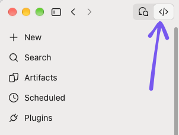

# Lane setup

Gets a Lane developer's Mac ready for the build plugins in the private
`TheLaneAgency/lane-dev-skills` repo (site generator, WordPress and hosting), from
the Claude app's Code tab.

Everyone else's Lane plugins, such as the timesheet and populate-content, come through
Lane's Claude Team account, and each one sets up what it needs the first time it runs.
They don't need this.

## Setting up

1. Open the Claude app and switch to **Claude Code**: the `</>` button at the top of
   the sidebar, beside the chat bubble.

   
2. Start a new session and paste:

   ```
   Set me up for Lane's dev plugins. Read https://raw.githubusercontent.com/TheLaneAgency/lane-setup/main/plugins/lane-setup/skills/lane-setup/SKILL.md and follow it.
   ```

Claude does the rest and tells you each time it needs a click from you: Apple's
installer, a GitHub code, a WebTracker token and the Chrome extension. Have these
ready:

- a GitHub account with access to `TheLaneAgency/lane-dev-skills` (ask Rob);
- a WebTracker login;
- Google Chrome.

At the end it runs the site generator's environment check and goes through anything
missing (Herd, WP-CLI, Node and the rest).

To run it again later, to fix a setup or pick up changes, type **run lane-setup** in a
Code tab session.

## What's here

This repository is public so it can be read before GitHub is signed in. It holds the
setup skill only. `plugins/lane-setup/skills/lane-setup/scripts/setup.sh` does the work;
`status` shows where a Mac stands.
